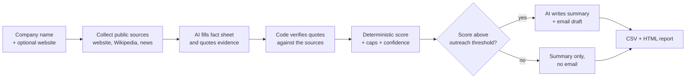

# AI Lead Research & Scoring Agent

Give it a company name. It researches public sources, scores the company as a B2B prospect from 0 to 100 with a written explanation for every point, and drafts a personalized outreach email. Emails are **drafts only and are never sent**.

Built as a portfolio project to show how AI can reduce manual lead research while keeping the qualification decision explainable and auditable.

## The business problem

Sales teams spend a lot of time checking whether a company is worth contacting: reading its website, scanning the news, comparing it with the Ideal Customer Profile (ICP), then writing a tailored email. This is repetitive, and the judgement behind it is rarely written down, so two people can score the same lead differently.

## The solution

The pipeline separates what AI is good at from what should be deterministic:

| Step | Who does it | Why |
|---|---|---|
| Collect public information | Code | Free sources, every source link is kept |
| Fill a fact sheet (industry, size, channels, growth signal) | AI | Reading messy text is what language models are good at |
| Verify each fact | Code | The AI must quote its evidence; if the quote is not in the sources, the fact becomes "unknown" |
| Score 0-100 | Code | Fixed, configurable rules: same facts, same score, every time |
| Write summary and email draft | AI | Only from verified facts |

Nothing is invented: a fact without verifiable evidence scores zero points, lowers the **confidence** value, and is listed as "Not verified" in the summary.



## The demo scenario

The scoring is relative to a seller. The demo uses **StockSense**, a *fictional* B2B SaaS company selling inventory forecasting software to online and omnichannel retailers (defined in [`config/icp.yaml`](config/icp.yaml)). A "good lead" here means a good prospect **for StockSense**. The prospects are real, well-known companies, scored from public information only.

### Example output (demo data)

Results of live runs on 2026-10-26 and 2026-10-27 (Esselunga was added in a later run) using `gemini-3.5-flash-lite`. The scores are an illustration of the method, not a statement about these companies.

| Company | Score | Tier | Why (short) |
|---|---|---|---|
| Warby Parker | 84 | High priority | Online + stores, 4,000+ employees, recent store openings |
| Chewy | 73 | High priority | Online retailer of physical goods, 18,100 employees |
| Allbirds | 55 | Medium | Strong product fit, but capped: news about exiting its core footwear business |
| Esselunga | 50 | Medium | Large grocery chain, recent expansion news, but stores only and classified as "other" industry (see limitations) |
| Etsy | 40 | Low / not a fit | Capped: a marketplace platform holds no inventory itself |
| Notion | 23 | Low / not a fit | Software product, no physical goods |

Full output: [`data/output/results.csv`](data/output/results.csv) and [`data/output/report.html`](data/output/report.html) (open in a browser).

<!-- After adding screenshots to docs/screenshots/, uncomment:


-->

## Features

- **Explainable score**: every criterion shows its points, the value found, and the quote that proves it.
- **Evidence check**: AI claims are verified against the collected sources before they count.
- **Confidence value**: shows how much of the score rests on verified facts. Below 60% the lead is flagged for manual review.
- **Business-rule caps**: e.g. a verified restructuring signal limits the score. Applied rules are displayed.
- **No email for poor fits**: leads below the outreach threshold get a summary only.
- **Configurable ICP**: weights, point values, caps and thresholds live in one YAML file.
- **Demo mode**: replays saved research snapshots with no internet and no API key; scoring is recomputed, so editing `icp.yaml` changes the results immediately.
- **Free to run**: public sources plus the Gemini API free tier.

## Tech stack

Python (developed and tested on 3.13), `requests`, `PyYAML`, `pytest`. LLM: Google Gemini API (free tier, REST). Sources: company website (respecting `robots.txt`), Wikipedia/Wikidata APIs, Google News RSS. Output: CSV and a single static HTML file. No database, no web framework, no paid service.

## Quick start

```bash
pip install -r requirements.txt
python run.py --mode demo
```

Then open `data/output/report.html`. No API key needed.

### Live mode (fresh research)

1. Create a free key at <https://aistudio.google.com/apikey>.
2. Copy `.env.example` to `.env` and paste the key after `GEMINI_API_KEY=`.
3. Run one company or the whole list in `data/input/companies.csv` (`name,website`):

```bash
python run.py --mode live --company "Warby Parker"
```

Each live run saves a snapshot in `data/snapshots/`, which demo mode can replay later. The free tier has a small daily quota per model; if it runs out the tool says so (set `GEMINI_MODEL` in `.env` to try another model).

### Tests

```bash
pip install -r requirements-dev.txt
python -m pytest -q
```

The 22 tests use a fictional company and a fake LLM (no network): score arithmetic, caps, fabricated-evidence rejection, outreach gating, config validation, live-then-demo round trip, CSV/HTML output (including HTML escaping), HTML parsing and infobox parsing. The real Gemini call is not covered by automated tests; it was checked manually.

## Configure the ICP

Edit [`config/icp.yaml`](config/icp.yaml): seller description, criteria and weights (must add up to 100), points per value, caps, tier cut-offs, confidence threshold, outreach threshold. The weights in this repo are my illustrative choices for the fictional seller, not validated against real sales data.

## Project structure

```
config/icp.yaml        ICP, weights, caps, thresholds
src/leadagent/         collect.py  facts.py  scoring.py  drafting.py  pipeline.py  report.py  llm.py  cli.py
data/input/            companies.csv
data/snapshots/        saved research (demo mode replays these)
data/output/           results.csv, report.html (example output)
tests/                 pytest suite
docs/                  demo guide
run.py                 entry point
```

## Limitations

- The demo prospects are large, well-documented companies. For small or private companies, Wikipedia-based facts (especially employee count) are often missing, so confidence would be lower. Not yet tested on such companies.
- The evidence check proves a quote exists in a source, not that it supports the conclusion. A wrong classification with a real quote can pass; review borderline leads.
- The industry list is built around online and omnichannel retail. A stores-only retailer such as Esselunga falls into "other" and loses the industry points; a "physical retail" category would be the natural next addition.
- Email drafts are generic when the sources offer little. They are reviewed by a human, never sent.
- News search by company name picks up unrelated headlines for common names; the AI is told to ignore them but may err.
- Some sites block automated reading (robots.txt or bot protection); those fall back to Wikipedia and news.
- AI extraction can vary slightly between live runs. Demo mode is fully repeatable.
- Runs locally from the command line; there is no web interface yet.
- Not evaluated against real conversion data: no claims are made about time saved or sales results.

## Design notes

- **Why not n8n?** n8n was considered. The requirements here (deterministic scoring, evidence verification, replayable demo mode, unit tests) are easier to build and test in plain Python, and a visual workflow would not have added capability.
- **Why Gemini?** Its free tier keeps the project at zero cost.

## Attribution and what is reused

- **No code was copied** from other projects. Design ideas came from reading the descriptions of existing work: n8n community templates for lead research and scoring (e.g. [Groq + Tavily cold-email drafts](https://n8n.io/workflows/16725-generate-personalized-cold-email-drafts-from-google-sheets-with-groq-and-tavily), [AI-scored outreach with Ollama](https://n8n.io/workflows/13466-run-ai-scored-cold-email-outreach-and-follow-ups-with-ollama-and-gmail/)) and [gtm-lead-agent](https://github.com/withoneai/gtm-lead-agent) (MIT), whose idea of keeping the ICP in a config file and only drafting emails I adopted.
- **Original work here:** the evidence-verification step, deterministic scoring with caps and confidence, demo-mode snapshots, report generation, and tests.
- **Data in `data/snapshots/` (demo fixtures):** short excerpts of company websites (copyright of their owners), Wikipedia text (CC BY-SA 4.0, [Wikipedia contributors](https://en.wikipedia.org)), Wikipedia infobox figures, and news headlines retrieved via Google News RSS (each links to its publisher). They are included only to make the demo reproducible. If you are a rights holder and want something removed, open an issue.
- Company names are used to identify real companies; the project is not affiliated with, or endorsed by, any of them. StockSense is fictional.

## License

MIT, see [LICENSE](LICENSE). The data excerpts above remain under their original terms.
